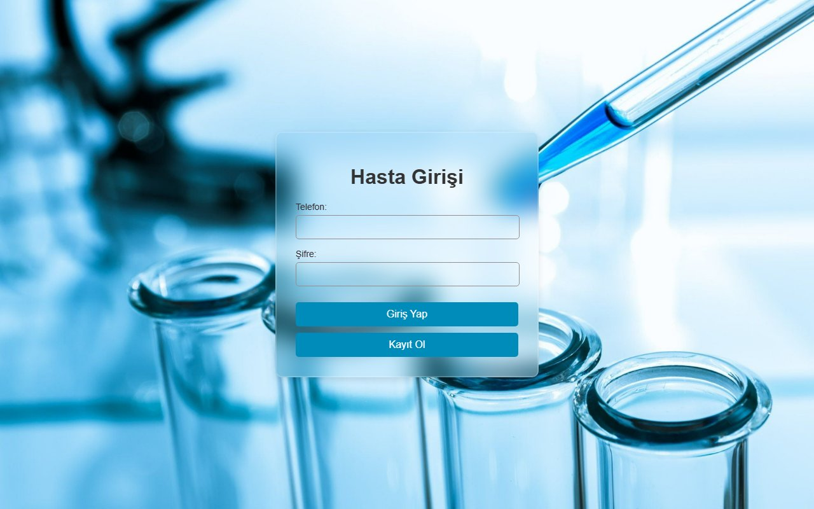
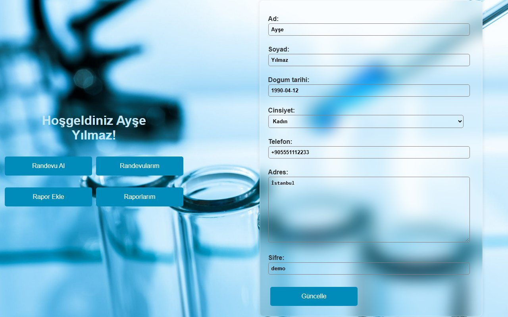
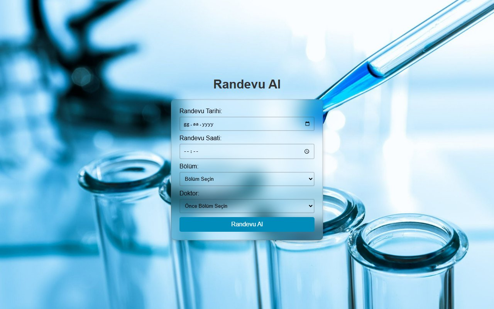
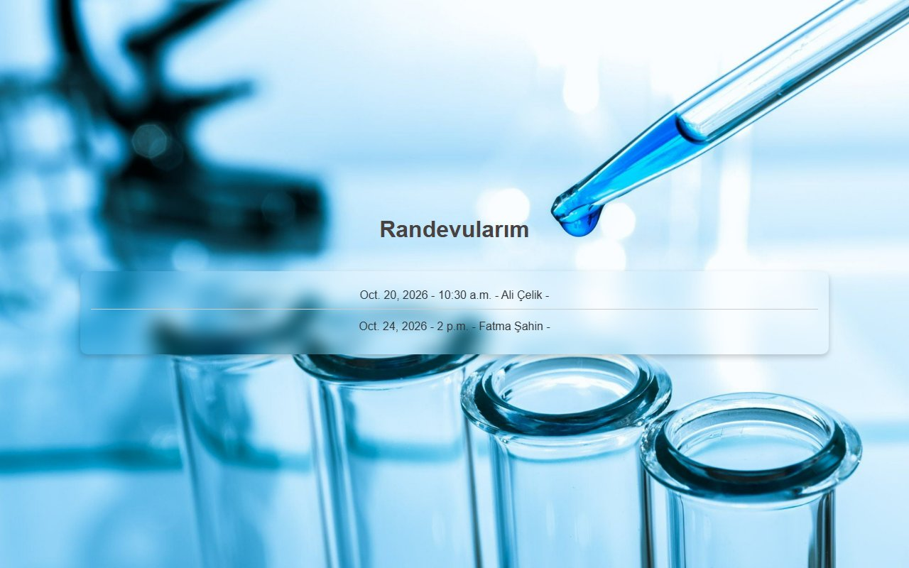
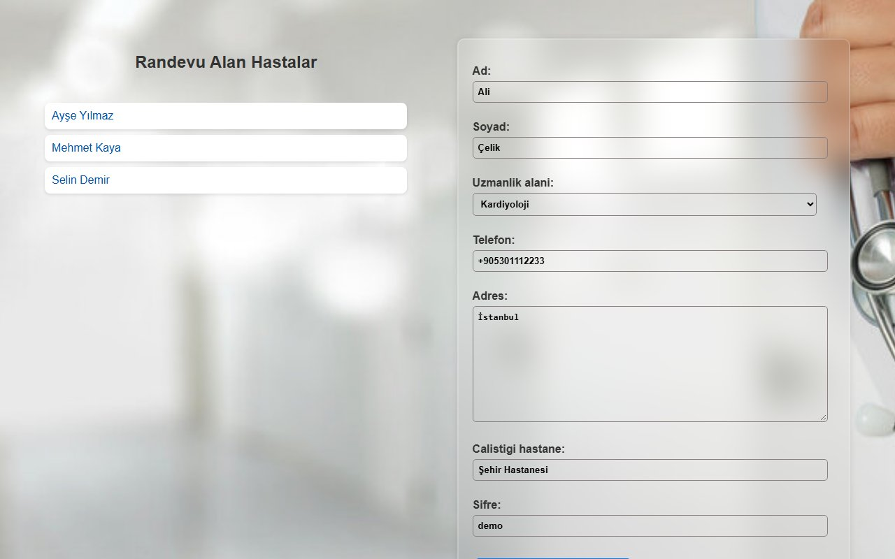
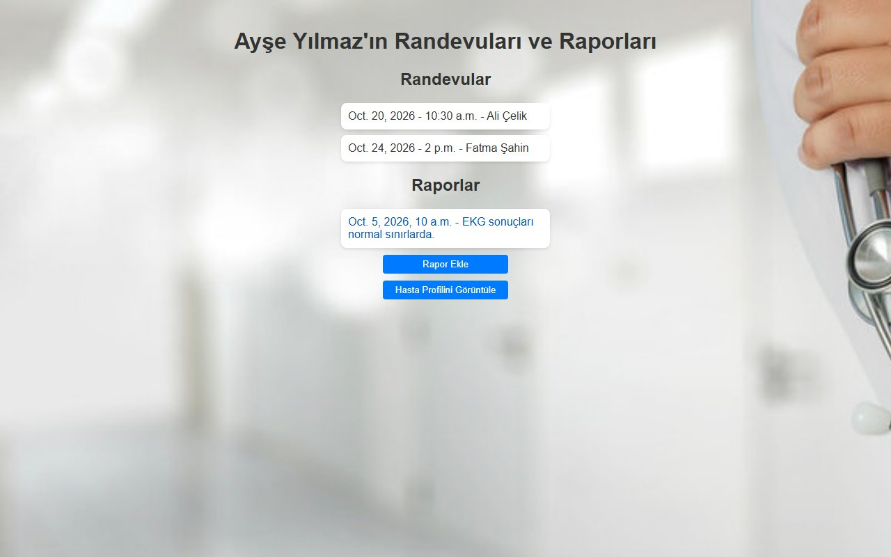
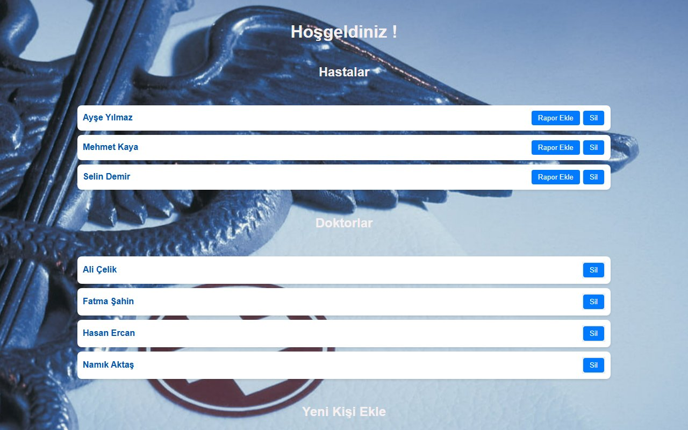

<div align="center">

# Hastane Yönetim Sistemi · Hospital Management System

**A Django web application for managing patients, doctors, appointments and medical reports.**


**English** · [Türkçe](#türkçe)


</div>

## About

A hospital management website with three separate roles — **patient**, **doctor** and **administrator** — each
with its own login and dashboard. Patients book appointments with doctors filtered by department, doctors see
the patients who booked with them and write reports, and administrators manage every patient and doctor in the
system. Report images are uploaded to Cloudinary.

The interface is in Turkish.

## Screenshots

| Patient login | Patient dashboard |
| :---: | :---: |
|  |  |
| **Book an appointment** | **My appointments** |
|  |  |
| **Doctor dashboard** | **Patient records (doctor view)** |
|  |  |

<p align="center"><b>Admin dashboard</b></p>



> Screenshots were taken with sample data.

## Features

### Patient
- Register and log in with phone number and password
- View and update personal information
- Book an appointment: pick a date, time and department — the doctor list is loaded for that department
- List upcoming appointments
- Upload a report (text + image) and view / download past reports

### Doctor
- Register and log in
- See the patients who booked an appointment
- Open a patient's appointments and reports, add a new report with an image
- Update profile (specialty, hospital, contact details)

### Administrator
- View every patient and doctor
- Add or delete patients and doctors
- View patient details and add reports for a patient
- Generate random sample patients and doctors with one click

**Departments:** Dermatology, Chest Diseases, Internal Medicine, Cardiology, Neurology, Psychiatry, General Surgery,
ENT, Gynecology & Obstetrics, Urology.

## Tech stack

| | |
| --- | --- |
| Backend | Python, Django |
| Database | PostgreSQL (`psycopg2`) |
| File storage | Cloudinary (`cloudinary`, `django-cloudinary-storage`) |
| Frontend | Django templates, HTML, CSS, JavaScript (Fetch API, Axios) |

## Getting started

**Requirements:** Python 3.9+, PostgreSQL and a Cloudinary account.

```bash
git clone https://github.com/ZehraAltunok1/Hospital_website.git
cd Hospital_website
python -m venv venv
venv\Scripts\activate          # macOS / Linux: source venv/bin/activate
pip install django psycopg2-binary cloudinary django-cloudinary-storage requests pillow
```

Fill in the placeholder values in `hastane_yonetimi/settings.py`:

- `SECRET_KEY`
- `DATABASES` — PostgreSQL database name, user, password and port
- `CLOUDINARY_STORAGE` — cloud name, API key and API secret
- `DEFAULT_FILE_STORAGE` — `'cloudinary_storage.storage.MediaCloudinaryStorage'`

Create the database tables, then start the server:

```bash
python manage.py migrate
python manage.py runserver
```

Open <http://127.0.0.1:8000>.

> **Note:** The views use raw SQL queries against tables named `hasta`, `doktor`, `yonetici`, `randevu` and
> `rapor`. Django's migrations create them with the app prefix (`app_hasta`, …), so either create tables with
> these names or add `db_table` to the models. An administrator account is added directly to the `yonetici` table.

## Project structure

```
Hospital_website/
├── hastane_yonetimi/        # Project settings and root URLs
├── app/
│   ├── models.py            # Hasta, Doktor, Yonetici, Randevu, Rapor
│   ├── views.py             # Login, dashboards, appointments, reports
│   ├── forms.py             # Patient, doctor and report forms
│   ├── urls.py
│   ├── templates/           # Page templates
│   └── static/app/img/      # Background images
├── docs/screenshots/        # README images
└── manage.py
```

## Data model

| Model | Description |
| --- | --- |
| `Hasta` | Patient — name, birth date, gender, phone, address, password |
| `Doktor` | Doctor — name, specialty, phone, address, hospital |
| `Yonetici` | Administrator — phone, password |
| `Randevu` | Appointment — patient, doctor, date, time |
| `Rapor` | Report — patient, doctor (optional), date, content, image |

---

## Türkçe

**Hastane Yönetim Sistemi**, hasta, doktor, randevu ve rapor yönetimi için Django ile geliştirilmiş bir web
uygulamasıdır. **Hasta**, **doktor** ve **yönetici** olmak üzere üç ayrı rol vardır; her rolün kendi giriş
sayfası ve paneli bulunur. Hastalar bölüme göre listelenen doktorlardan randevu alır, doktorlar kendilerinden
randevu alan hastaları görüp rapor yazar, yöneticiler ise sistemdeki tüm hasta ve doktorları yönetir. Rapor
görselleri Cloudinary'ye yüklenir.

### Özellikler

**Hasta**
- Telefon numarası ve şifre ile kayıt olma ve giriş yapma
- Kişisel bilgileri görüntüleme ve güncelleme
- Randevu alma: tarih, saat ve bölüm seçimi — doktor listesi seçilen bölüme göre gelir
- Randevuları listeleme
- Rapor yükleme (metin + görsel), geçmiş raporları görüntüleme ve indirme

**Doktor**
- Kayıt olma ve giriş yapma
- Randevu alan hastaları görme
- Hastanın randevu ve raporlarını açma, görselli yeni rapor ekleme
- Profil bilgilerini (uzmanlık alanı, hastane, iletişim) güncelleme

**Yönetici**
- Tüm hasta ve doktorları görüntüleme
- Hasta ve doktor ekleme veya silme
- Hasta detaylarını görme ve hastaya rapor ekleme
- Tek tıkla rastgele örnek hasta ve doktor oluşturma

**Bölümler:** Dermatoloji, Göğüs Hastalıkları, İç Hastalıkları, Kardiyoloji, Nöroloji, Psikiyatri, Genel Cerrahi,
Kulak Burun Boğaz, Kadın Hastalıkları ve Doğum, Üroloji.

### Kullanılan teknolojiler

Python, Django, PostgreSQL, Cloudinary, HTML, CSS, JavaScript (Fetch API, Axios).

### Kurulum

**Gereksinimler:** Python 3.9+, PostgreSQL ve bir Cloudinary hesabı.

```bash
git clone https://github.com/ZehraAltunok1/Hospital_website.git
cd Hospital_website
python -m venv venv
venv\Scripts\activate
pip install django psycopg2-binary cloudinary django-cloudinary-storage requests pillow
```

`hastane_yonetimi/settings.py` dosyasındaki şu alanları kendi bilgilerinizle doldurun: `SECRET_KEY`,
`DATABASES` (PostgreSQL bilgileri), `CLOUDINARY_STORAGE` (Cloudinary bilgileri) ve `DEFAULT_FILE_STORAGE`
(`'cloudinary_storage.storage.MediaCloudinaryStorage'`).

```bash
python manage.py migrate
python manage.py runserver
```

Tarayıcıda <http://127.0.0.1:8000> adresini açın.

> **Not:** View'lar `hasta`, `doktor`, `yonetici`, `randevu` ve `rapor` adlı tablolara doğrudan SQL sorgusu
> gönderir. Django migration'ları tabloları uygulama önekiyle (`app_hasta`, …) oluşturduğu için tabloları bu
> isimlerle oluşturun ya da modellere `db_table` ekleyin. Yönetici hesabı doğrudan `yonetici` tablosuna eklenir.

### Ekran görüntüleri

Ekran görüntüleri yukarıdaki [Screenshots](#screenshots) bölümündedir (örnek verilerle alınmıştır).

<div align="center">

Zehra Altunok · [GitHub](https://github.com/ZehraAltunok1)

</div>
